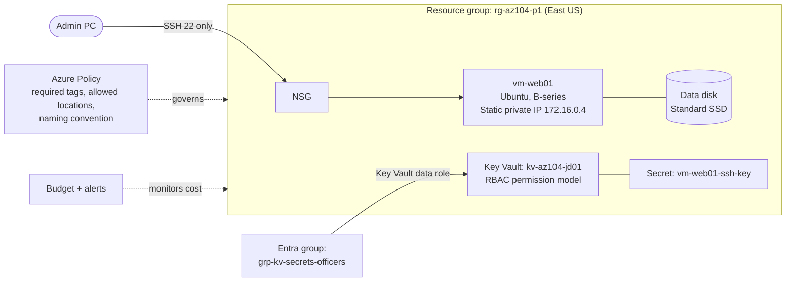
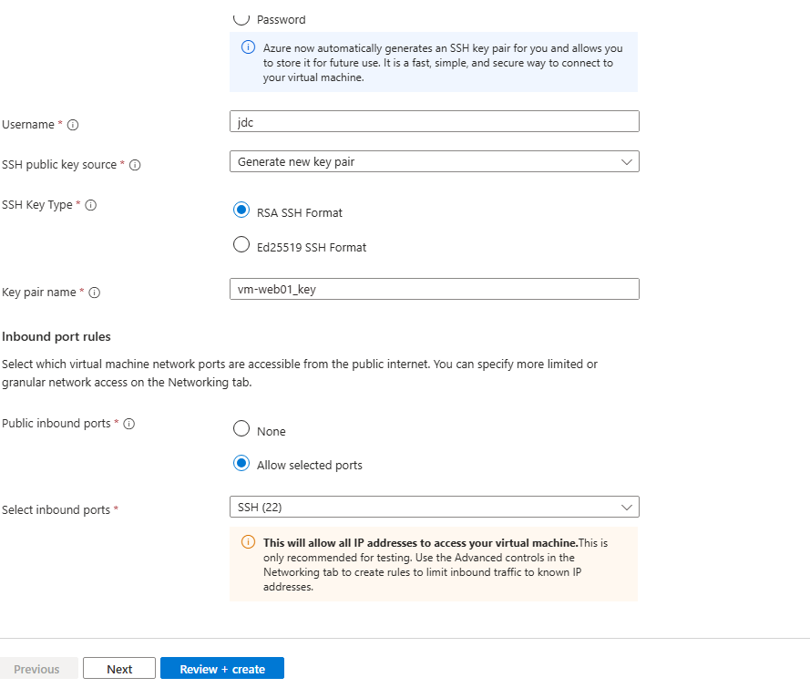
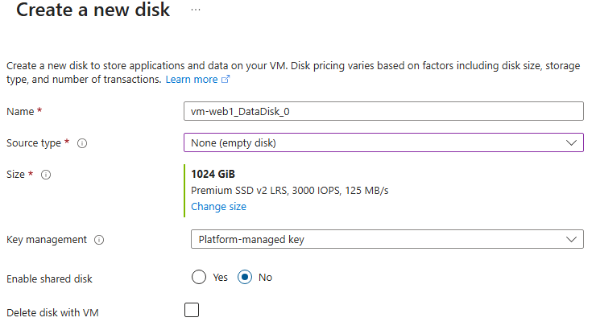
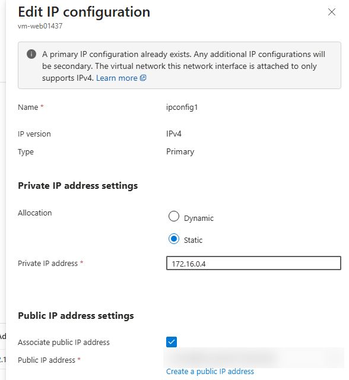
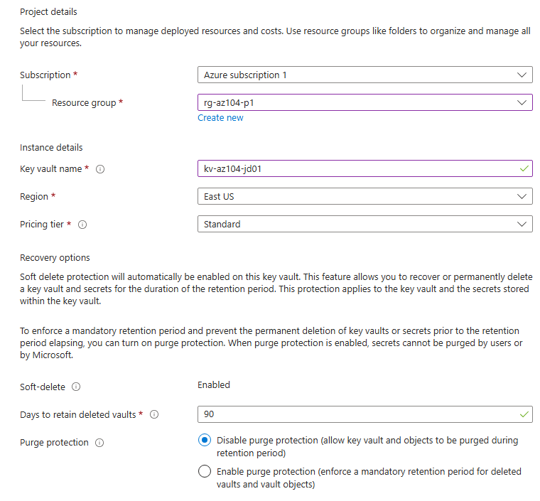
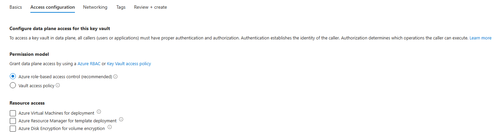
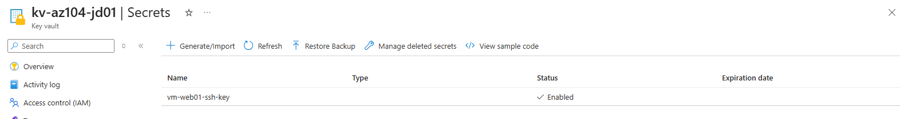

# Project 1: Compute, Identity and Governance

**Services:** Linux VM, managed disks, NSG, Azure Key Vault, Entra ID groups, Azure RBAC, Azure Policy, Cost Management, Azure Advisor

## Scenario

A company needs a virtual machine for a web application. It must be secured with role-based access control, its credentials stored safely, resources governed by policy, and costs monitored.

## Architecture

## What I built

### 1. Virtual machine
- Deployed **vm-web01**, an Ubuntu VM on a burstable B-series size, in **rg-az104-p1** (East US).
- Used **SSH key authentication** instead of a password, with a newly generated RSA key pair (**vm-web01_key**).
- Added a separate **data disk** during creation, so application data is kept apart from the OS disk.
- Set the NIC's private IP allocation to **Static (172.16.0.4)** so the address never changes.
- Allowed **only SSH (22)** inbound through the VM's network security group.

### 2. Storing the SSH key in Key Vault
- Created **kv-az104-jd01** in the **same resource group and region** as the VM, using the **Azure RBAC permission model** (Microsoft's recommended model) rather than legacy access policies.
- Created the Entra ID group **grp-kv-secrets-officers**, added myself, and gave the group a Key Vault data-plane role on the vault. Assigning roles to **groups instead of individual users** makes access easier to manage.
- Stored the VM's private SSH key as the secret **vm-web01-ssh-key**, using Cloud Shell, so the key isn't left sitting on a laptop.

### 3. Access control on the VM
- Assigned **Virtual Machine Contributor** on the VM, which lets someone manage the VM without being able to sign in to it or grant access to others.
- Verified group membership and role assignments in Entra ID and the VM's **Access control (IAM)** blade.

### 4. Governance with Azure Policy
Assigned three policies, **scoped to the lab's resource group** so they couldn't affect anything else in the subscription:
- **Require a tag** on resources, so every resource can be traced to an owner, project or cost centre.
- **Allowed locations**, so resources can only be created in approved regions.
- **Naming convention**, so resource names follow a consistent pattern.

Then tested that non-compliant deployments were **denied**, and checked compliance from **VM → Operations → Policies**.

### 5. Cost management
- Created a monthly **budget** with alert thresholds at **50%, 80% and 100%**.
- Reviewed **Cost analysis** for trends and **Azure Advisor** for cost recommendations.

## Key decisions

| Decision | Why |
|---|---|
| SSH keys instead of a password | Keys can't be guessed or brute-forced like passwords |
| Static private IP | Other systems and firewall rules can rely on a fixed address |
| Key Vault with the RBAC model | Access is managed with the same Azure roles as everything else, and plain Contributors can't grant themselves access to secrets |
| Roles assigned to a group | Adding or removing a person is a group change, not a role change |
| Virtual Machine Contributor | Least privilege: manage the VM, but no OS sign-in and no ability to grant access |
| Policies scoped to the resource group | Enforces the rules on this workload without breaking other projects in the subscription |

## Validation

- Connected to the VM over **SSH from my own PC** using the private key.
- Browsed to the VM's public IP over HTTPS and confirmed it was **not reachable**, because the NSG only allows SSH.
- Confirmed the secret was stored and **enabled** in Key Vault.
- Tried deploying resources **without the required tag, in a non-allowed region and with a non-compliant name**, and confirmed each was **denied** by policy.

## Screenshots

| | |
|---|---|
| SSH key authentication on the VM  | Separate data disk  |
| Static private IP (public IP redacted)  | Key Vault in the same region and resource group  |
| Azure RBAC permission model  | SSH key stored as a secret  |

## What I learned

- **Control plane vs data plane:** a role like Contributor manages the Key Vault resource, but reading secrets inside it needs a separate data role.
- **Role assignments take time** to apply. Signing out and back in refreshes your token.
- Key Vault **soft delete is always on** (90 days by default), so a deleted vault or secret can be recovered.
- Policy **remediation** is needed to fix resources that existed before an assignment.

## Cleanup

Deleted the **rg-az104-p1** resource group, which removed every resource inside it.
