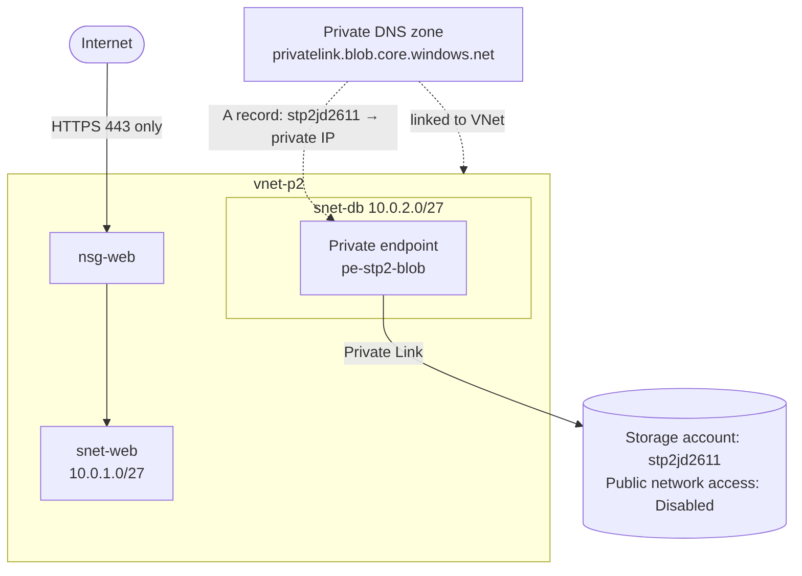

# Project 2: Networking and Secure Storage

**Services:** Virtual network, subnets, NSG, service endpoints, storage account, private endpoint, private DNS zone, SAS, Azure Storage Explorer, AzCopy, ARM templates, Template Specs

## Scenario

A company needs a secure storage account, with network isolation between its web and database tiers, data encrypted at rest, and deployments that can be repeated from templates.

## Architecture



## What I built

### 1. Network
- Created **vnet-p2** with two subnets, one per tier:
  - **snet-web** (10.0.1.0/27) for the web tier
  - **snet-db** (10.0.2.0/27) for the database tier, with a **Microsoft.Storage service endpoint**
- Subnets in the same VNet can talk to each other by default, so isolation is enforced with NSG rules.

### 2. Network security group
- Created **nsg-web** and associated it with **snet-web**.
- **Allowed HTTPS (443)** from the internet at priority 100.
- Added a rule to **deny all other inbound internet traffic**. Default rules can't be edited, but a custom rule with a lower priority number overrides them.

### 3. Storage account locked down with a private endpoint
- Created **stp2jd2611** (Standard, LRS) with **Microsoft-managed encryption keys**.
- **Disabled public network access**, so the account can't be reached from the internet.
- Created the private endpoint **pe-stp2-blob** in **snet-db** for the **blob** service. This gives the storage account a **private IP inside my VNet**.
- Integrated it with the private DNS zone **privatelink.blob.core.windows.net**, linked to the VNet, so the normal storage name resolves to the **private IP** from inside the network.

### 4. Testing access
- Because public network access was disabled, my own PC (outside the VNet) couldn't reach the account. To test from it, I **temporarily allowed public access from my own public IP address only** (selected networks), then **disabled public access again** once testing was done.
- Generated a **shared access signature (SAS)** with limited permissions and an expiry time.
- Connected with **Azure Storage Explorer** using the SAS URL, created a container, and uploaded and downloaded files.
- Uploaded a test file from the command line with **AzCopy**:

```
azcopy copy "file-to-upload.txt" "https://<account>.blob.core.windows.net/<container>/file-to-upload.txt?<SAS token>"
```

### 5. Repeatable deployments
- Used **Automation → Export template** to export the VNet and storage account as **ARM templates**.
- Imported them as **Template Specs** and **redeployed** from the Template Spec to confirm the resources could be recreated consistently.

## Key decisions

| Decision | Why |
|---|---|
| Separate web and database subnets | Each tier gets its own rules, and a compromised web tier doesn't automatically reach the data tier |
| Private endpoint instead of a service endpoint alone | A service endpoint keeps the storage account on a public address. A private endpoint gives it a private IP, allows public access to be switched off completely, and works from on-premises over VPN. |
| Private DNS zone integration | Apps keep using the normal storage name, and DNS returns the private IP inside the VNet |
| SAS for testing | Temporary, limited access without handing out the account key |
| Template Specs | Store a template in Azure so it can be redeployed and shared consistently |

## Validation

- Storage Explorer could **list, upload and download** blobs with the SAS URL.
- The AzCopy upload succeeded.
- The redeployment from the Template Spec completed successfully.

## What I learned

- **A SAS is not a network bypass.** It grants permission, but the storage firewall still decides whether the connection is allowed at all. With public access disabled, a valid SAS from outside the VNet is still blocked.

- **Private endpoint DNS** is the part that makes or breaks it: the private endpoint needs a `privatelink` zone with an A record, linked to the VNet. Without it, the name still resolves to the public IP.
- **Auto-registration** on a private DNS zone only creates records for VMs, not for private endpoints.
- **Account SAS vs service SAS vs user delegation SAS**, and why a stored access policy makes a SAS easy to revoke.
- **AzCopy copy** is for moving data; **AzCopy sync** keeps two locations matched.

## Cleanup

Deleted the **rg-az104-p2** resource group after testing.
