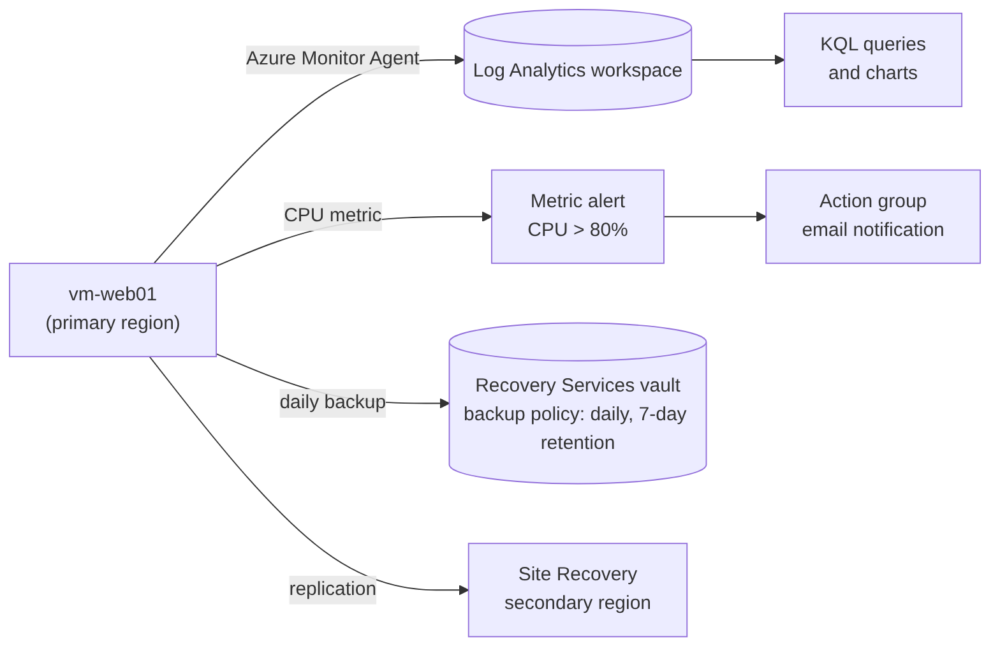

# Project 3: Monitoring, Backup and Disaster Recovery

**Services:** Azure Monitor, VM insights, metric alerts, action groups, Log Analytics, KQL, Recovery Services vault, Azure Backup, Azure Site Recovery

## Scenario

A company wants to spot performance problems early, recover data after a failure, survive a regional outage, and analyse logs for insights. This project reuses the VM from [Project 1](../01-compute-identity-governance/).

## Architecture



## What I built

### 1. Monitoring
- Enabled **VM insights** on the VM, which installs the **Azure Monitor Agent** and sends performance data to a **Log Analytics workspace**.
- Created a **metric alert** for **CPU above 80%**, connected to an **action group** that sends an email notification.

### 2. Backup
- Created a **Recovery Services vault**.
- Configured a **backup policy** with **daily backups** and a **7-day retention** period.
- Enabled backup for the VM, ran a **manual backup**, and confirmed the job completed.
- Checked the vault's encryption settings: backup data is **encrypted at rest**, and traffic to the vault uses **TLS**.

### 3. Disaster recovery
- Enabled **Azure Site Recovery** replication of the VM to a **secondary region**.
- Reviewed the replication policy and ran a **test failover**, which starts a copy of the VM in an isolated network without affecting the running VM.
- Monitored replication health.

### 4. Log analysis with KQL
Queried the workspace for average CPU in 5-minute intervals, then displayed the result as a chart:

```kusto
Perf
| where ObjectName == "Processor" and CounterName == "% Processor Time"
| summarize Avg_CPU = avg(CounterValue) by bin(TimeGenerated, 5m)
| render timechart
```

## Key decisions

| Decision | Why |
|---|---|
| Metric alert for CPU | CPU is a platform metric, so it alerts quickly without a log query |
| Action group | One reusable set of notifications that any alert can use |
| Recovery Services vault in the VM's region | Azure VM backup requires the vault in the same region as the VM |
| Site Recovery to a second region | Backups restore data; Site Recovery keeps the workload running if a whole region fails |
| Test failover before relying on DR | Proves recovery works without touching production |

## What I learned

- **Backup vs disaster recovery:** backup protects against data loss and deletion; Site Recovery protects against an outage.
- For Site Recovery, the vault lives in the **target (DR) region**; for VM backup it lives in the **same region** as the VM.
- The failover sequence is **failover → commit → reprotect → failback**.
- **KQL basics:** `where` filters rows, `project` picks columns, `summarize` counts or averages, `render` draws charts.
- Azure Backup **soft delete** keeps deleted backup data for 14 days.

## Cleanup

Stopped protection, deleted the backup data, disabled replication, then removed the resource groups.

> Resource names in this project are representative.
