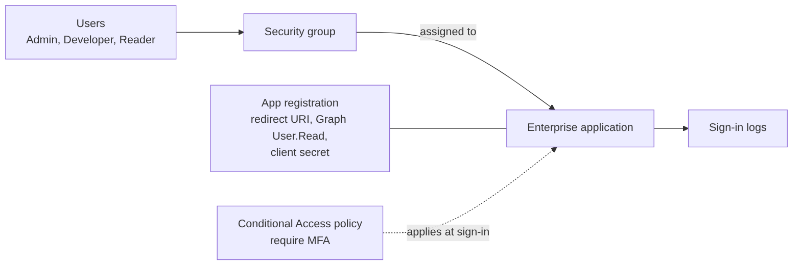

# Project 4: Entra ID Identity and Access

**Services:** Microsoft Entra ID users and groups, app registrations, enterprise applications, Microsoft Graph API permissions, Conditional Access, multi-factor authentication, sign-in logs

## Scenario

A company wants its web application to sign users in with Microsoft Entra ID, manage access through groups, enforce Conditional Access, and require MFA.

## Architecture

## What I built

### 1. Users and groups
- Created test users for different roles (**Admin, Developer, Reader**).
- Created a **security group** and added the users to it.

### 2. App registration
- Registered an application with a **redirect URI** for a web app.
- Added the **Microsoft Graph User.Read** API permission, so the app can read the signed-in user's profile.
- Created a **client secret** so the app can prove its identity.

### 3. Assigning access through the enterprise application
- Opened the app under **Enterprise applications** (its service principal in my tenant).
- Assigned the **group** to the application, so access is controlled by group membership.

### 4. Conditional Access and MFA
- Created a **Conditional Access** policy that **requires MFA** for users signing in to the application, and explored conditions such as location and device compliance.
- Enabled **MFA** for selected users and tested that sign-in prompted for it.

### 5. Monitoring sign-ins
- Reviewed **Sign-in logs** to confirm successful and failed attempts, including which Conditional Access policies applied.

## Key decisions

| Decision | Why |
|---|---|
| Assign the app to a group, not individuals | Access follows group membership, so joiners and leavers are handled in one place |
| Least-privilege Graph permission (User.Read) | The app only gets the data it actually needs |
| Conditional Access for MFA | Targets specific apps and conditions instead of forcing MFA everywhere in the same way |

## What I learned

- **App registration vs enterprise application:** the registration is the app's definition; the enterprise application is its identity (service principal) in a tenant.
- **Delegated vs application permissions:** delegated acts on behalf of a signed-in user; application permissions let a background service act as itself and need admin consent.
- Conditional Access needs **Entra ID P1**; Privileged Identity Management needs **P2**.
- **Client secrets expire** and should be stored in Key Vault, or replaced with managed identities where possible.

## Cleanup

Deleted the test users, group, Conditional Access policy and app registration.

> User, group and app names in this project are representative.
