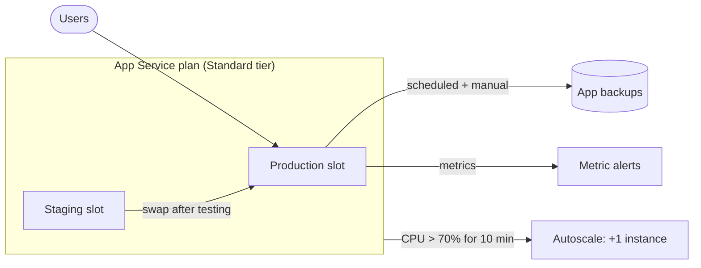

# Project 5: App Service Deployment and Scaling

**Services:** Azure App Service, App Service plans, deployment slots, autoscale, App Service backups, Azure Monitor metrics and alerts

## Scenario

A company wants to host a web application on Azure App Service, test new versions safely before release, scale automatically with demand, and be able to restore the app after a failure.

## Architecture

## What I built

### 1. App Service
- Created a web app with a **runtime stack**, on an **App Service plan** in a tier that supports slots and autoscale.

### 2. Deployment
- Deployed a sample web application and verified it by browsing to the app's URL.

### 3. Deployment slots
- Added a **Staging** slot and deployed a new version to it.
- Tested it, then **swapped** Staging with Production to release it with no downtime. Swapping back is an instant rollback.

### 4. Autoscale
- Configured **autoscale** on the App Service plan, with a rule to **add one instance when CPU is above 70% for 10 minutes**.

### 5. Backups
- Configured a **backup schedule**, ran a **manual backup**, and verified it by **restoring to a new App Service**.

### 6. Monitoring
- Monitored app performance with **metrics** such as CPU and response time.
- Created **alerts** for when metrics exceed thresholds.

## Key decisions

| Decision | Why |
|---|---|
| Standard tier or above | Deployment slots and autoscale aren't available on Free, Shared or Basic |
| Staging slot with swap | Releases with no downtime and an instant rollback path |
| Scale out on CPU | More instances handle more requests; the cooldown stops it reacting to brief spikes |
| Restore to a new app | Proves the backup works without overwriting the live app |

## What I learned

- **App Service plan tiers:** Basic adds custom domains and TLS; **Standard** adds autoscale and **5 slots** (up to 10 instances); **Premium v3** allows **20 slots** and 30 instances; **Isolated** runs in your own VNet.
- **Scale up vs scale out:** bigger instances vs more instances.
- **Slot settings ("sticky")** stay with their slot during a swap, which is useful for things like test database connection strings.
- Every app in a plan runs on **every instance** of that plan.

## Cleanup

Deleted the resource group containing the app, its slot and the App Service plan.

> Resource names in this project are representative.
